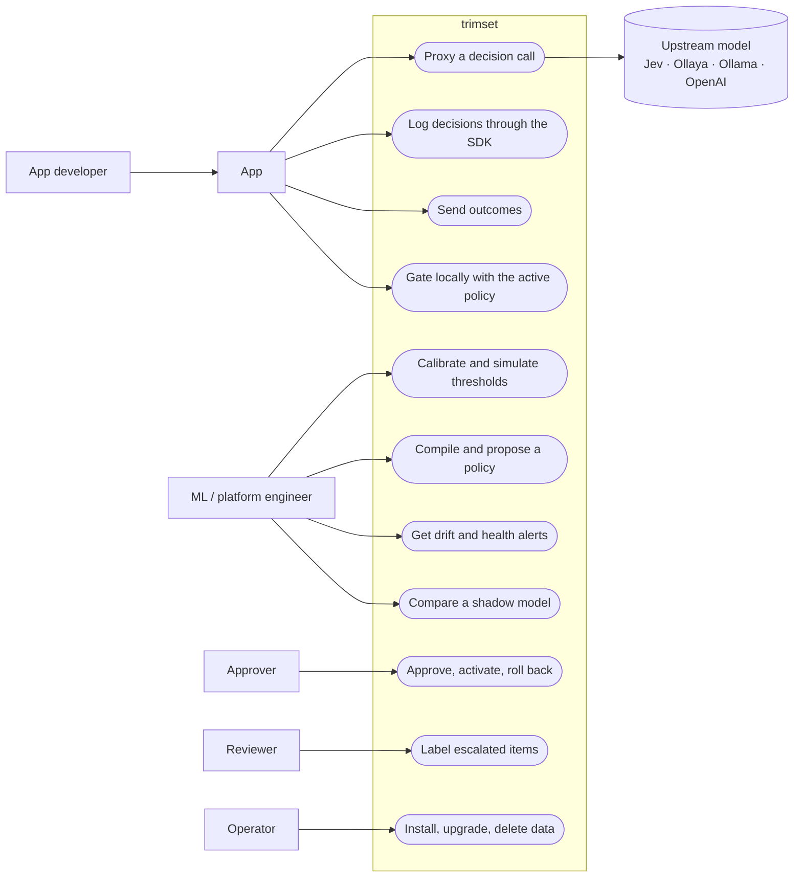
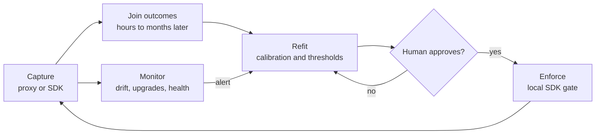
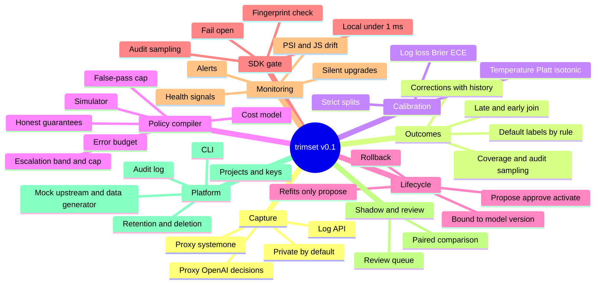

# Phase 1: Requirements

**Status:** approved 2026-11-10, with the Phase 2 refinements noted on FR-01, FR-07, FR-09 and FR-52 · Inputs: [kickoff.md](kickoff.md), [00-discovery.md](00-discovery.md)

## 1. Vision

Decision models answer typed questions with probabilities in milliseconds. Teams turn
those probabilities into actions with thresholds they guess once and never revisit.
Meanwhile three things go wrong:
- the model is upgraded behind an alias;
- the traffic shifts;
- the truth about each decision (a chargeback, a reassigned ticket, a moderator's call)
  arrives hours to months later in some other system, and is never joined back to the
  decision.

trimset closes that loop, self-hosted and open source. It:
- captures every decision;
- joins each one to its real outcome when that arrives;
- refits calibration and thresholds;
- proposes a new policy that says what it guarantees, and puts it live only after a
  human approves;
- alerts when the model or the traffic drifts.

Adopting it takes one base-URL change.

**In one line:** Langfuse for decision models: thresholds that stay true.

### Release scope

| Area | v0.1 (milestones M1 to M5, launch M7) | v0.2 | Later |
|---|---|---|---|
| Capture | Log API; proxy for `/v1/systemone` and `/v1/decisions` | More upstreams once verified (Azure OpenAI and others) | |
| Outcomes | API, late join, corrections, default labels by rule, audit sampling | | |
| Stats | Calibration, policy compiler (one risk target plus an escalation cap), simulator | Several error budgets at once; guarantees per slice | |
| Runtime | Python SDK with local gate | TypeScript SDK | |
| Monitoring | Drift, silent upgrades, health signals, alerts | | |
| Compare and label | Shadow comparison; review queue through API and CLI | Review screen in the dashboard | |
| Interface | CLI | Web dashboard ([design prompt](design/dashboard-prompt.md)) | |
| Platform | One `docker compose`; projects; API keys | | ClickHouse for very large volumes; SSO |

## 2. Glossary

| Term | Meaning |
|---|---|
| Decision model | A model that answers typed questions about a state with probabilities instead of text (Jev, models served by Ollaya or Ollama, OpenAI decisions). |
| State | What the question is about: a message, a ticket, any JSON. |
| Question | One typed question in a request. |
| Type (primitive) | `noul`: one yes/no probability. `choice`: one probability per option, K options. `score`: one probability per level, levels 0 to L-1. |
| `question_id` | A stable hash of the type, the exact wording, and the options or levels in order. Change one word and it is a new question. |
| `model_requested` / `model_served` | The model name the app asked for (`jev-latest`) and the exact version that answered (`jev-1.13.0`). |
| Group | `(question_id, model_served, type)`. Fits and policies belong to exactly one group and are never pooled across groups. |
| Upstream | The model server trimset's proxy forwards to. |
| Decision record | What trimset stores for each answered question: the probabilities, models, latency, cost, tags, hashes, and the action taken. |
| Outcome | The truth about a decision, which arrives later. A label (yes/no, an option, or a level) plus its source. |
| Label source | `human_review`, `downstream` (another system's signal, such as a chargeback or a ticket reassignment), or `rule` (a default after a timeout). |
| Action | What the app does: `ACCEPT`, `BLOCK`, `SELECT:<label>` or `ESCALATE`. |
| Auto-decided | Any action except `ESCALATE`. |
| Escalation band | The range `[lo, hi)` of probabilities that gets `ESCALATE`, meaning it goes to a bigger model or a human. This is the System 1 to System 2 hand-off. |
| Error budget | The highest allowed share of auto-decided items whose action turned out wrong. |
| False-pass rate | The share of `ACCEPT`ed items that should have been blocked. "2% of refunds we paid were fraud." |
| Escalation rate | The share of decisions that got `ESCALATE`. |
| Fit | A calibration map for one group (temperature, Platt or isotonic), with the data it was fitted on recorded. |
| Policy | The versioned thresholds and action mapping for one group, with a SHA-256 fingerprint, metrics and a guarantee statement. |
| Guarantee | A claim such as "false-pass rate ≤ 2% with 95% confidence", together with the assumptions it rests on (enough labeled items; future traffic resembling the tuning data). |
| Drift | A change in the distribution of probabilities (label-free), or in calibration once labels arrive. |
| Silent upgrade | `model_served` changes while `model_requested` stays the same. |
| Shadow | A candidate model called on a copy of live traffic. Only the primary model's answer goes back to the app. |
| Audit sampling | Sending a small random share of decisions to review whatever their probability, so that every action path gets true labels. |
| Project | The unit of separation. Every record, key, policy and setting belongs to one. |

## 3. Personas

| Persona | Who | Wants | Pain today | Touches |
|---|---|---|---|---|
| **App developer** | Owns the service that calls the decision model. | To adopt in minutes; a `gate()` call that never breaks the request path. | Hard-coded `if p > 0.9`; no idea whether 0.9 means 90%. | Proxy, SDK |
| **ML / platform engineer** | Owns model quality across teams. | Calibration, drift and evidence before a threshold changes; to compare models before switching. | Offline notebooks; labels that arrive late and scattered. | CLI, API, alerts |
| **Approver** | Owns the business risk, for example the fraud-operations lead or the trust-and-safety lead. | To see the trade-off in business terms, approve with an audit trail, and roll back fast. | Threshold changes slipped into code with no review. | CLI (dashboard in v2) |
| **Reviewer** | Labels escalated items: a risk analyst, a dispatcher or a moderator. | Fast labeling, with enough context and no data they shouldn't see. | Context spread across tools. | Review queue |
| **Operator** | Self-hosts trimset. | One compose file, a small VM, backups, upgrades, deletion requests. | Heavy stacks (Kafka, ClickHouse) for a side tool. | Compose, CLI |

## 4. Use cases: real-world examples

The ★ ones get runnable demos in `examples/` (Phase 5) and pages on the site. All six
are scenarios in the synthetic data generator (FR-60).

### UC-1 ★ Refund fraud

An online shop pays refunds automatically. Before paying one, its refund service asks a
decision model about the request.

- **Question:** "Is this refund request fraudulent?" (noul). `external_ref` is the refund id.
- **Actions:**
  - p < lo → `ACCEPT` (pay out)
  - lo ≤ p < hi → `ESCALATE` (risk team)
  - p ≥ hi → `BLOCK` (hold the refund)
- **Outcomes:**
  - a chargeback or a confirmed fraud case, 30–90 days later (`downstream`);
  - the risk team's verdict on escalated refunds (`human_review`);
  - no chargeback within 120 days → "not fraud" (`rule`).
- **Target:** false-pass rate ≤ 2% with 95% confidence, and at most 15% escalated.
- **Why it's hard:** labels arrive months late, and "no news" is itself a label. Held
  refunds almost never get a true label, so 1% audit sampling keeps the refits honest.
- **Exercises:** FR-04, FR-10, FR-13, FR-14, FR-21, FR-23, FR-33, FR-37.

### UC-2 ★ Support ticket triage

An online shop routes incoming tickets to one of four teams.

- **Question:** "Which team should handle this ticket?" (choice: billing, shipping,
  returns, tech). `external_ref` is the ticket id.
- **Actions:**
  - the top option's probability ≥ t → `SELECT:<team>`
  - otherwise → `ESCALATE` (a human dispatcher)
- **Outcomes:**
  - the team that finally closed the ticket, from the help desk's webhook, hours later
    (`downstream`);
  - no reassignment within 72 hours → the first routing was right (`rule`).
- **Target:** misroutes ≤ 5% among auto-routed tickets, with 95% confidence.
- **Why it's hard:** `jev-latest` moving to a new version changes the probabilities
  overnight.
- **Exercises:** FR-05, FR-20, FR-31, FR-39.

### UC-3 ★ Model routing

A chat product sends easy requests to a small model and hard ones to a large model.

- **Question:** "How hard is this request?" (score, levels 0–3).
- **Actions:**
  - P(level ≥ 2) < t → `ACCEPT` (the small model answers)
  - otherwise → `ESCALATE` (the large model answers)
- **Outcomes:**
  - an LLM judge grades a 2% sample of answers with the true level (`downstream`);
  - a thumbs-down or a retry within 10 minutes of a small-model answer means the request
    was harder than predicted (`downstream`).
- **Target:** cost model. A large-model call costs $0.012 and a bad small-model answer
  costs $0.20 (illustrative). Minimise the expected cost per 1,000 requests.
- **Why it's hard:** a cost target gives the cheapest expected point, not a guarantee,
  and the policy says so (FR-25).
- **Exercises:** FR-21, FR-25, FR-26, FR-45.

### UC-4 PII guardrail

A company's internal chat assistant checks every prompt before it reaches an LLM.

- **Question:** "Does this text contain personal data?" (noul).
- **Actions:**
  - p ≥ hi → `BLOCK`
  - band → `ESCALATE` (redact, or send to a human)
  - p < lo → `ACCEPT`
- **Outcomes:**
  - the privacy team reviews a weekly sample of passed prompts (audit sampling,
    `human_review`);
  - the company's data-loss scanner flags leaks (`downstream`).
- **Target:** false-pass rate ≤ 1% with 95% confidence.
- **Why it's hard:** the raw prompts are exactly what must not be stored. Reviewers open
  the prompt in the company's own tool through a link template (FR-50).
- **Exercises:** FR-09, FR-14, FR-50.

### UC-5 Agent tool approval

An operations agent wants to run a database write or send an email.

- **Question:** "Is this tool call safe to run without a human?" (noul; p is the
  probability that it is safe).
- **Actions:**
  - p ≥ hi → `ACCEPT` (run it)
  - band → `ESCALATE` (ask a human)
  - p < lo → `BLOCK`
- **Outcomes:**
  - the human's approve or deny on escalated calls (`human_review`);
  - incident reports on calls that ran, rare and late (`downstream`).
- **Target:** unsafe passes ≤ 0.5% with 95% confidence.
- **Why it's hard:** bad events are rare. Claiming ≤ 0.5% at 95% confidence needs about
  600 labeled auto-run calls with no incident (exact binomial bound; the "rule of three"
  gives 3/n). Before that, trimset says "not enough labels: 412 more needed" instead of
  guessing (FR-23).
- **Exercises:** FR-20, FR-23, FR-35.

### UC-6 Content moderation

A marketplace checks new listings before they go live.

- **Question:** "How serious is the problem with this listing?" (score: none, mild,
  serious, remove).
- **Actions:**
  - "remove" → `BLOCK`
  - mild or serious → `ESCALATE` (the moderator queue)
  - none → `ACCEPT`

  Cut points are set on the cumulative probabilities.
- **Outcomes:**
  - the moderator's decision (`human_review`);
  - user reports on live listings, days later (`downstream`).
- **Target:** at most 2,000 items a day in the review queue, with the fewest errors under
  that cap.
- **Why it's hard:** the binding constraint is people's time, not an error rate.
- **Exercises:** FR-21, FR-24, FR-47.

## 5. User journeys

**J1 · Adopt (app developer)**
1. `docker compose up -d`.
2. `trimset admin create-key`, then create a project, an ingest key and the upstream (for example a local Ollaya).
3. Point the app's `TYPESAFE_BASE_URL` at trimset. No code changes.
4. Watch decisions arrive: `trimset decisions tail`.
5. To link outcomes later, read the `X-Trimset-Decision-Id` response header, or send your own id in `X-Trimset-External-Ref`.

**J2 · Close the loop (app developer)**
1. Point the help desk's or payment processor's webhook at `POST /v1/outcomes`.
2. Add a default-by-rule ("no chargeback within 120 days → not fraud").
3. Check coverage: `trimset outcomes coverage refund_fraud` shows the share of decisions with a label, for each action path.

**J3 · First policy (ML engineer, then approver)**
1. `trimset calibrate refund_fraud` shows the raw and calibrated metrics and a reliability table.
2. `trimset simulate refund_fraud --lo 0.30 --hi 0.85` shows the trade-off.
3. `trimset policy compile refund_fraud --false-pass 0.02 --confidence 0.95 --max-escalation 0.15` creates a proposal.
4. The approver reads the diff and the guarantee: `trimset policy show`.
5. The approver approves and activates it.
6. SDKs pick it up within 60 seconds, and the app calls `gate()`.

**J4 · Drift (ML engineer)**
1. A Slack alert says the probability distribution shifted, with the evidence.
2. `trimset drift show refund_fraud` gives the details.
3. Then one of three things: wait for a refit proposal, roll back, or pin the model version upstream.

**J5 · Silent upgrade (ML engineer)**
1. An alert says `jev-latest` now answers as `jev-1.14.0`.
2. The active policy no longer applies (it is bound to `jev-1.13.0`), so the SDK returns its configured default.
3. Labels are collected for the new version.
4. A new policy is compiled for it and approved.

**J6 · Try a cheaper model (ML engineer)**
1. Set `laya:latest` on Ollaya as the shadow model for 20% of traffic.
2. Wait for labeled pairs.
3. `trimset shadow report` shows the comparison.
4. Switch the upstream, then compile and approve a policy for the new model.

**J7 · Review (reviewer)**
1. Run `trimset review`.
2. Claim an item and see its question, probabilities, tags and a link into the app.
3. Label it with one key, then move to the next.

**J8 · Operate (operator)**
- Back up Postgres.
- Upgrade: pull the new images, then migrate.
- Rotate keys.
- Handle a deletion request: `trimset data delete --external-ref rf-1001`.

## 6. Diagrams

### Use cases

### The loop

## 7. User stories

**US-01 · App developer · Adopt with one base URL** (FR-04, FR-07, FR-08)
As an app developer, I want my decision calls to go through trimset by changing only the
base URL, so I get logging without touching code.
- **Given** a project whose upstream is a local Ollaya, **when** my app sends its unchanged `POST /v1/systemone` to trimset, **then** it gets Ollaya's status and body back unchanged, plus an `X-Trimset-Decision-Id` header.
- **Given** that call, **then** one decision record per question is stored within 5 seconds.
- **Given** Postgres is down, **when** my app calls the proxy, **then** the call still succeeds and the dropped-records counter goes up.

**US-02 · App developer · Log without risk** (FR-01, FR-36)
As an app developer, I want `log()` to never slow down or break my service.
- **Given** the trimset server is unreachable, **when** I call `log()`, **then** it returns immediately without raising, and the record is retried with backoff.
- **Given** the buffer is full, **when** I call `log()`, **then** the oldest record is dropped and counted, and memory stays within its limit.

**US-03 · App developer · Send an outcome months later** (FR-10, FR-11)
- **Given** a decision logged 45 days ago with `external_ref` `rf-1001`, **when** I post an outcome for `rf-1001` with label `true` and source `downstream`, **then** it is joined to that decision and is used by the next refit.
- **Given** an outcome arrives before its decision, **when** the decision arrives within 30 days, **then** the two are joined.

**US-04 · App developer · Correct a label** (FR-12)
- **Given** an outcome `false`, **when** a later outcome says `true`, **then** the current label is `true`, and the history shows both with their sources and times.

**US-05 · App developer · No news is a label** (FR-13)
- **Given** the rule "no chargeback within 120 days → `false`", **when** 120 days pass with no outcome, **then** the label `false` is recorded with source `rule`.
- **Given** a real outcome arrives after that, **then** it overrides the rule's label.

**US-06 · ML engineer · See calibration** (FR-15 to FR-18)
- **Given** 1,000 or more labeled decisions for `refund_fraud` on `jev-1.13.0`, **when** I run `trimset calibrate refund_fraud`, **then** I see log loss, Brier and ECE (equal-width and equal-mass), raw against calibrated, on the evaluation split, plus a reliability table.
- **And** no fit is ever evaluated on the items it was fitted on.

**US-07 · ML engineer · Too few labels** (FR-19, FR-23)
- **Given** 43 labeled decisions, **when** I calibrate or compile, **then** trimset declines with "43 labeled items; at least 200 needed" (the minimum is configurable).

**US-08 · ML engineer · Policy with a guarantee** (FR-20 to FR-23, FR-25)
- **Given** a fit, **when** I ask for a false-pass rate ≤ 2% with 95% confidence and at most 15% escalated, **then** I get a proposed policy with its thresholds, fingerprint, metrics with exact 95% intervals on the evaluation split, and a guarantee statement that names its assumptions and sample sizes.

**US-09 · ML engineer · Impossible targets** (FR-24)
- **Given** targets that can't all be met, **when** I compile, **then** the result says "infeasible", names the constraint that binds, shows the best achievable trade-off, and creates no policy.

**US-10 · ML engineer · Try thresholds** (FR-26)
- **When** I run `trimset simulate refund_fraud --lo 0.30 --hi 0.85`, **then** I see the share automated, the error rate on the automated path with its 95% interval, the share escalated, and the expected cost.

**US-11 · Approver · Approve with a trail** (FR-27, FR-28, FR-54)
- **Given** a proposed policy, **when** an admin key approves and activates it, **then** the previous active version is retired, and an event records who did it, when, and why.
- **Given** an ingest-only key, **when** it tries to approve, **then** the request is refused (403).

**US-12 · Approver · Roll back** (FR-29, NFR-05)
- **Given** v8 is active and v7 came before it, **when** I run `trimset policy rollback refund_fraud`, **then** v7 is active in every running SDK within 60 seconds.

**US-13 · ML engineer · Refits only propose** (FR-30)
- **Given** a daily refit schedule, **when** a refit finds a better policy, **then** a proposal with a diff against the active policy exists and a "proposal ready" alert is sent. **Nothing is activated.**

**US-14 · App developer · Gate locally** (FR-32, FR-33, NFR-04)
- **Given** an active policy for `refund_fraud` on `jev-1.13.0` is cached, **when** I call `gate("refund_fraud", p=0.83, model="jev-1.13.0")`, **then** it returns `ESCALATE` with policy v7, in under 1 ms at p99, with no network call.

**US-15 · App developer · Fail open** (FR-35)
- **Given** the server is unreachable and nothing is cached, **when** I call `gate()`, **then** it returns my configured default action with source `default`, and doesn't raise.

**US-16 · App developer · Tampered policy** (FR-34)
- **Given** a fetched policy whose fingerprint doesn't match its content, **then** the SDK rejects it, keeps the last good policy, and reports an error.

**US-17 · App developer · Wrong model** (FR-31)
- **Given** the active policy is for `jev-1.13.0`, **when** `gate()` is called with `model_served = jev-1.14.0`, **then** that policy is not applied, the default is returned, and the reason says "no policy for this model".

**US-18 · ML engineer · Drift that matters** (FR-38, FR-43)
- **Given** a 7-day reference window, **when** the probability distribution shifts (PSI ≥ 0.2, permutation-test p < 0.01, at least 500 decisions in the window), **then** one Slack alert is sent, with the report.
- **Given** a window of only 30 decisions with a similar PSI, **then** no alert is sent.

**US-19 · ML engineer · Silent upgrade** (FR-39)
- **Given** `jev-latest` was answering as `jev-1.13.0`, **when** it starts answering as `jev-1.14.0`, **then** within 5 minutes an alert names both versions and says the active policy no longer applies.

**US-20 · ML engineer · Compare a shadow model** (FR-45, FR-46)
- **Given** `laya:latest` shadows 20% of traffic, **when** there are 1,000 paired decisions of which 300 are labeled, **then** the report shows agreement, flip rate, the McNemar p-value, and cost and latency deltas.
- **And** the app only ever received the primary model's answers, with its p99 latency unchanged (within 1 ms).

**US-21 · Reviewer · Label without seeing private data** (FR-47 to FR-50)
- **Given** an escalated refund, in a project that stores no raw state, **when** I claim it, **then** I see the question, the probabilities, the tags and a link to the shop's own refund page built from `external_ref`.
- **When** I label it "fraudulent", **then** an outcome is recorded with source `human_review` and my key's id.

**US-22 · Operator · Install** (FR-53, NFR-01)
- **Given** a clean Linux VM with Docker, **when** I run `docker compose up -d`, **then** `/ready` answers 200 within 2 minutes of the images being pulled, and `trimset admin create-key` prints the first admin key. There are no default passwords.

**US-23 · Operator · Upgrade** (NFR-15)
- **Given** v0.1.0 holding data, **when** I upgrade to v0.1.1, **then** migrations run once and all data is intact.

**US-24 · Operator · Delete a customer's data** (FR-57, NFR-14)
- **When** I delete by `external_ref`, **then** within 1 hour its decisions, outcomes, review items and raw state are gone, and no fit or policy keeps item-level data from it.

**US-25 · Operator · Revoke a leaked key** (FR-52)
- **Given** a revoked key, **when** it is used, **then** it is refused within 60 seconds of revocation.

## 8. Functional requirements

Each requirement lists its release and milestone. M6 (dashboard) moved to v2 in Phase 0.

### A. Capture

- **FR-01 Decision logging API** (v0.1, M1). `POST /v1/decisions:log` takes one record or a batch (Phase 3 fixes the limits; the starting point is 1,000 records or 1 MB). The fields are as in the brief:
  - `decision_id`, `project_id`, `timestamp`
  - `question_id`, type, options or levels
  - `model_requested`, `model_served`
  - the raw probabilities, `latency_ms`, `cost_usd`
  - `policy_version`, `action_taken`, `tags`, `external_ref`, `state_hash` (the brief's `state_sha256`, now keyed: [ADR 0009](adr/0009-privacy-model.md))

  Writes are idempotent by `decision_id`: sending the same record again stores it once. The reply gives a status for each record.
- **FR-02 Validation** (v0.1, M1). Probabilities must lie in [0, 1]. Choice and score probabilities must sum to 1 within 1e-3, then are renormalised before use (Phase 3: vendors round to 4 decimals). Their count must match the question's options or levels. Valid records in a batch are stored; invalid ones come back with reasons.
- **FR-03 Questions** (v0.1, M1).
  - The server computes `question_id` from the type, the exact wording, and the options or levels in order (canonical form and test vectors in Phase 3).
  - A client-sent id must match it, or the record is rejected.
  - A question is registered the first time it is seen.
- **FR-04 Proxy for `/v1/systemone`** (v0.1, M1).
  - Forwards to the project's upstream: TypeSafe's Jev, Ollaya, or Ollama 0.35.0 and later (0.40.5 for cloud models; corrected in Phase 3).
  - Returns the upstream's status and body unchanged.
  - Logs one decision record per question asynchronously. A logging failure never fails the request.
- **FR-05 Proxy for `/v1/decisions`** (v0.1, M1). The same behaviour for OpenAI's decisions format. The format follows the project's upstream setting, not the path: Ollaya serves the systemone format at `/v1/decisions` too (Phase 3).
- **FR-06 Upstream settings** (v0.1, M1).
  - Each project sets its upstream base URL and timeout.
  - Upstream credentials are either passed through from the app's request (never stored) or held server-side.
  - The upstream can be any address the operator configures, including localhost (Ollaya listens on 11435).
- **FR-07 What the proxy records** (v0.1, M1).
  - From the request and response: `model_requested`, `model_served` and `latency_ms`.
  - `cost_usd`, from token usage and a per-model price table in the configuration. Prices are configuration, never code; an unknown model gives an empty cost.
  - `state_sha256`.
  - Optional request headers set `X-Trimset-External-Ref` and `X-Trimset-Tags`. The response gains an `X-Trimset-Decision-Id` header, with one id per question, comma-separated in question order ([ADR 0011](adr/0011-proxy-design.md)).
- **FR-08 One-base-URL adoption** (v0.1, M1). In proxy mode, trimset must know the project without the app adding headers or changing its body. Phase 2 picks the mechanism; it weighs that a key inside a URL can end up in logs.
- **FR-09 Private by default** (v0.1, M1).
  - Raw `state` is never stored unless the project switches on "store raw state" (an audited setting, with its own shorter retention).
  - Only hashes and tags are kept.
  - Tags have size limits and an optional per-project allow-list of keys, so personal data can't slip in through tags.
  - `state_hash` is a keyed hash (HMAC-SHA-256, with the key derived from a server secret held outside the database): [ADR 0009](adr/0009-privacy-model.md).

### B. Outcomes

- **FR-10 Outcomes API** (v0.1, M1). `POST /v1/outcomes` takes one outcome or a batch.
  - It names a decision by `decision_id`, or by `external_ref` plus `question_id`.
  - The label is typed: `true`/`false` for noul, an option for choice, a level for score.
  - It carries a source (`human_review`, `downstream` or `rule`) and `observed_at`.
  - It is idempotent, and its flat JSON is easy to send from a webhook.
- **FR-11 Late and early outcomes** (v0.1, M1).
  - An outcome can arrive at any time within the retention period.
  - One that arrives before its decision is held as unmatched (30 days by default) and joined when the decision arrives.
  - When held outcomes expire unmatched, they are counted.
- **FR-12 Corrections** (v0.1, M1). The last outcome received wins. The full history (label, source, key, time) is kept.
- **FR-13 Default labels by rule** (v0.1, M1).
  - A question can set "if no outcome within D days, record label L with source `rule`".
  - A real outcome that arrives later overrides it.
- **FR-14 Label coverage and audit sampling** (v0.1, M2 for coverage, M3 for sampling).
  - trimset reports, for each group and action path, the share of decisions with a label and the median delay.
  - It warns when an action path has almost no labels: for example, blocked refunds never get a chargeback.
  - A policy can set an audit fraction (0 by default). The SDK sends that random share to `ESCALATE` whatever the probability, and flags it `audit` (FR-37).
  - The compiler uses audited items to estimate errors on paths that otherwise lack labels. This addresses the selective-labels problem (research source to be verified in Phase 2).

### C. Calibration

- **FR-15 Never pooled** (v0.1, M2). Fits are made separately for each group.
- **FR-16 Methods** (v0.1, M2).
  - noul: temperature scaling, Platt scaling and isotonic regression.
  - choice and score: at least temperature scaling. Phase 2 research decides the others.
  - The method is chosen on the calibration data and reported on the evaluation split.
- **FR-17 Metrics** (v0.1, M2).
  - Log loss, Brier score, and ECE both equal-width and equal-mass (15 bins by default, configurable).
  - Reliability-diagram data: for each bin, the count, the mean predicted value, the observed frequency and its interval.
  - All raw against calibrated.
- **FR-18 Strict splits** (v0.1, M2).
  - Labeled items are split three ways (fit, tune, eval), assigned by a hash of `decision_id`.
  - Every fit records which items it used.
  - trimset refuses to tune or evaluate on items a fit was trained on.
- **FR-19 Windows and minimums** (v0.1, M2).
  - Fits use a time window (the last 90 days of labeled items by default) and need a minimum number of labeled items (200 by default).
  - Below the minimum, trimset says how many more are needed.

### D. Policy compiler

- **FR-20 Action mapping** (v0.1, M2). Each question says how probabilities become actions:
  - **noul:** which side means `BLOCK` and which means `ACCEPT`; the band [lo, hi) means `ESCALATE`.
  - **choice:** `SELECT:<option>` when the top option's probability reaches t (optionally a separate t per option); otherwise `ESCALATE`. Options can map to `BLOCK` (for example "spam").
  - **score:** cut points map levels to actions.
- **FR-21 Targets** (v0.1, M2). A target is one of:
  - an error budget or a false-pass cap, with a confidence level (95% by default) and an optional escalation cap; or
  - a cost model (the cost of an escalation and the cost of each kind of wrong action), optionally with an escalation cap.

  Several budgets at once comes in v0.2.
- **FR-22 Output** (v0.1, M2). A policy is versioned per group (v1, v2, …) and uses schema `policy/1`. It carries:
  - a SHA-256 fingerprint over its canonical JSON;
  - metrics on the tune and eval splits: share automated, share escalated, error or false-pass rate with its exact 95% interval, and expected cost;
  - where it came from: the fit, the time window, and the item count per split.
- **FR-23 Small samples** (v0.1, M2).
  - Guarantees use exact bounds (Clopper-Pearson, or the method Phase 2 picks), never point estimates.
  - When there are too few labeled items to support the target, the compiler declines and says how many more it needs. For example, ≤ 0.5% at 95% needs about 600 error-free items.
- **FR-24 Impossible targets** (v0.1, M2). trimset says which constraint binds and shows the best achievable values. It creates no policy.
- **FR-25 Honest guarantees** (v0.1, M2).
  - Every policy carries `guarantee`: either the statement, its method, its assumptions and its item counts, or `none` with the reason. Reasons include a cost-only target, or drift detected since the tuning window.
  - Where assumptions are known to break, trimset uses the adaptive methods from Phase 2 research and labels the result "adaptive, no guarantee".
  - It never shows a guarantee it can't back.
- **FR-26 Simulator** (v0.1, M2).
  - For a group and some candidate thresholds (or a grid of them), it returns the FR-22 metrics on the eval split.
  - It is used by `trimset simulate`, the homepage's trade-off table (with numbers from demo data) and the v2 dashboard.

### E. Policy lifecycle

- **FR-27 States** (v0.1, M3). A policy moves draft → proposed → approved → active → retired, or proposed → rejected. Every transition is an event recording the key, the time and the reason.
- **FR-28 Who approves** (v0.1, M3).
  - Only admin keys can approve, activate or roll back.
  - Rejecting or rolling back requires a reason.
- **FR-29 One active policy per group** (v0.1, M3).
  - Activating a version retires the previous one.
  - Rollback re-activates the previous approved version in one command.
- **FR-30 Scheduled refits only propose** (v0.1, M3).
  - Refits run on a schedule per project (daily by default).
  - A refit produces a proposal with a diff against the active policy, plus a "proposal ready" alert.
  - Refits never activate anything in v0.x.
- **FR-31 Bound to its model** (v0.1, M3). A policy applies only to its own `(question_id, model_served)`. It is never applied to another model version or another wording.

### F. Runtime gate (Python SDK)

- **FR-32 Fetch and cache** (v0.1, M3).
  - The SDK pulls the project's active policies every 30 s by default, with jitter, and only downloads when they have changed (ETag).
  - It keeps the last good set in memory, and optionally on disk so it survives restarts.
- **FR-33 `gate()`** (v0.1, M3).
  - It takes the question, the probabilities, `model_served` and, optionally, a `decision_id`.
  - It returns the action, the label (for `SELECT`), the policy version, the source (`policy`, `default` or `audit`) and the reason.
  - It runs purely locally. Given a `decision_id` (in proxy mode, from the proxy's header), it reports the action it took through `POST /v1/decisions:actions` (Phase 3).
- **FR-34 Fingerprint check** (v0.1, M3). Before using a policy, the SDK recomputes its fingerprint. On a mismatch it rejects that policy, keeps the last good one, and logs and counts an error.
- **FR-35 Fail open** (v0.1, M3).
  - When no policy applies (server unreachable, nothing cached, model mismatch), `gate()` returns the default action configured for that question.
  - The library's own default when none is configured is set in the fail-open ADR (Phase 2).
  - `gate()` never raises.
- **FR-36 `log()` and `outcome()`** (v0.1, M3). Both are non-blocking and batched on a background thread, and retry with exponential backoff and jitter. Their buffer is bounded: when full, the oldest record is dropped, and drop counts are reported to the server.
- **FR-37 Audit sampling in the gate** (v0.1, M3). The SDK applies the policy's audit fraction, decided deterministically by a hash of `decision_id`. Audited decisions return `ESCALATE` with source `audit`.

### G. Drift and health

- **FR-38 Label-free drift** (v0.1, M4).
  - For each group, the current window (the last 24 hours by default) is compared with a reference window (7 days by default).
  - The comparison uses the population stability index (PSI) and Jensen-Shannon divergence, with a permutation-test p-value.
  - It alerts only when the effect is large enough (PSI ≥ 0.2 by default), significant (p < 0.01 by default), and the window holds at least 500 decisions by default.
- **FR-39 Silent upgrades** (v0.1, M4).
  - A new `model_served` for the same `model_requested` creates an event and an alert within 5 minutes.
  - The alert names both versions and says the active policy no longer applies (FR-31).
  - Only possible where the upstream names the version that answered: fully on TypeSafe, partly on Ollaya, not on Ollama or OpenAI, which echo the requested name ([wire-formats.md](03-api/wire-formats.md); Phase 3).
- **FR-40 Health signals** (v0.1, M4):
  - the escalation rate moving away from what the policy expected;
  - jumps in upstream errors (proxy);
  - latency regressions at p50 and p99;
  - calibration getting worse once labels arrive (recent ECE compared with ECE at fit time).
- **FR-41 Drift reports** (v0.1, M4). Drift reports are stored (schema `drift_report/1`) and can be read through the API and the CLI.

### J. Alerts

- **FR-42 Channels** (v0.1, M4): webhook (the body signed with HMAC, with retries), Slack (incoming webhook), and email (SMTP).
- **FR-43 Rules** (v0.1, M4).
  - Thresholds are set per project and can be overridden per question.
  - A repeat of the same alert is held back during a cool-down (1 hour by default).
  - A "resolved" notice is sent when the condition clears.
- **FR-44 Alert types** (v0.1, M4):
  - drift; a silent upgrade; escalation-rate shift; upstream errors; latency; calibration degradation;
  - proposal ready; policy activated or rolled back;
  - records dropped; outcome join backlog; review queue over capacity.

### H. Shadow comparison

- **FR-45 Shadow traffic** (v0.1, M5). Each question can name a candidate upstream or model, a sample share (10% by default) and a daily call cap. The proxy calls the candidate after the primary has answered. The candidate never changes the response or its latency, and its failures are only logged.
- **FR-46 Paired comparison** (v0.1, M5). For each question, `trimset shadow report` shows:
  - agreement, and the flip rate of actions under the active policy;
  - an exact McNemar test on labeled pairs;
  - accuracy and log loss on labeled pairs;
  - cost and latency deltas.

### I. Review queue

- **FR-47 What gets queued** (v0.1, M5).
  - Each question chooses whether escalated items, audited items or both are queued.
  - The queue is ordered by age and by how close each item is to a threshold.
  - An alert fires when the queue exceeds its capacity.
- **FR-48 Working the queue** (v0.1, M5).
  - API and CLI commands list, claim (a 15-minute lease by default), label and skip.
  - `trimset review` is a keyboard-driven labeling session in the terminal.
  - The web screen comes with the v2 dashboard.
- **FR-49 Labels become outcomes** (v0.1, M5). A reviewer's label is recorded as an outcome with source `human_review` and the reviewer's key id.
- **FR-50 Context without raw state** (v0.1, M5).
  - Reviewers see the question, options, probabilities, tags and `external_ref`.
  - A per-question link template, such as `https://shop.example/admin/refunds/{external_ref}`, opens the item in the app's own tool.
  - Raw state is shown only if the project stores it.

### K. Projects, keys and audit

- **FR-51 Projects** (v0.1, M1). Every record, key, policy and setting belongs to one project. There are no reads across projects.
- **FR-52 API keys** (v0.1, M1).
  - A proxy key can only call the proxy endpoints; it is the key that sits in a base URL ([ADR 0011](adr/0011-proxy-design.md)). A review key can only work the review queue (added in Phase 3). An ingest key can log, send outcomes, use the proxy and read active policies. An admin key can do all of that, plus approvals and settings.
  - Keys are stored as hashes, shown once, and revocable, and their last use is recorded.
  - A revocation takes effect within 60 seconds.
- **FR-53 Bootstrap** (v0.1, M1). The first admin key is created with a CLI command on the server. There are no default credentials.
- **FR-54 Audit log** (v0.1, M3). Records policy transitions, key creation and revocation, changes to settings and privacy, and deletions, each with the key, the time, and the before and after values.

### M. CLI

- **FR-55 CLI** (v0.1, from M2, growing with each milestone). Everything the v2 dashboard will show is available in the CLI. Output is a readable table by default, or JSON with `--json`. Phase 3 names the commands.

### N. Data management

- **FR-56 Retention** (v0.1, M5).
  - Decisions and outcomes are kept 400 days by default; fraud labels need 120 days plus a 90-day fit window.
  - Stored raw state is kept 30 days by default.
  - Old time partitions are dropped.
- **FR-57 Deletion** (v0.1, M5).
  - Data can be deleted by project, by `external_ref` or by time range.
  - Deletion reaches the outcomes, review items and raw state.
  - Fits and policies keep only aggregates, never item-level data.
- **FR-58 Export** (v0.1, M5). Decisions and their outcomes for a group and a time range can be exported as JSONL, for offline analysis and the `research/` experiments.

### O. Developer tooling

- **FR-59 Mock upstream** (v0.1, M1). It serves `/v1/systemone` and `/v1/decisions` with deterministic probabilities derived from a seed and the state's hash. Latency and errors can be injected, and the model version can be switched to simulate a silent upgrade.
- **FR-60 Synthetic data generator** (v0.1, M1).
  - It has scenarios for all six use cases.
  - It can plant miscalibration, drift, a silent model swap, outcome delays and missing labels.
  - It uses fixed seeds and writes through the API or as JSONL.
  - All tests and demos use it.

### L. Dashboard (v2)

- **FR-61 Web dashboard** (v2). The screens are those in [design/dashboard-prompt.md](design/dashboard-prompt.md). Every screen's data is already available from the v0.1 API.

## 9. Non-functional requirements

| ID | Requirement | Verified by |
|---|---|---|
| NFR-01 | `docker compose up -d` on a machine with Docker gives `/ready` 200 within 2 minutes of the images being pulled. No account and no outside service are needed. | Install test in CI |
| NFR-02 | Ingestion: `POST /v1/decisions:log` p99 < 20 ms per request, at 2,000 decisions/s sustained for 10 minutes (batches of 1–100), on a 2 vCPU / 4 GB VM with Postgres on the same VM. An acknowledged record is committed. | Load test |
| NFR-03 | The proxy adds < 5 ms at p99 compared with calling the mock upstream directly, at 500 requests/s with logging on. Met by the Rust proxy ([ADR 0015](adr/0015-rust-proxy.md)). | Load test |
| NFR-04 | `gate()` p99 < 1 ms with 1,000 policies cached, and no network call on that path. | Benchmark |
| NFR-05 | An activation or rollback reaches every running SDK within 60 seconds. | Integration test |
| NFR-06 | The proxy keeps forwarding when Postgres is slow or down. Records are buffered up to a limit, then dropped, counted and alerted on; they never hold up a response. | Chaos test |
| NFR-07 | The SDK never raises into app code, never blocks on the network, and holds at most a bounded number of records in memory (10,000 by default). | Chaos test |
| NFR-08 | Statistical correctness: metrics and bounds match scipy and scikit-learn on fixed seeds (to 1e-9 for deterministic metrics, to a documented tolerance for fits). Each method reproduces one published result. | Golden tests |
| NFR-09 | Guarantees hold: on synthetic data that meets the assumptions, a policy's actual false-pass rate on fresh data is within its target in at least 95% of 200 seeds (for a 95% guarantee). | Coverage experiment |
| NFR-10 | A single node holds 100 million decisions, using time partitions and retention. Reading one group's last 30 days takes under 2 s. | Load test |
| NFR-11 | Security: keys are stored as hashes; secrets never appear in logs, traces or errors; outgoing webhooks are signed; TLS through a documented reverse proxy; no default credentials. CI runs a dependency audit and a secret scan. | CI, threat model |
| NFR-12 | Privacy: raw state is never stored, logged or traced unless the project opts in. trimset collects no telemetry. | Unit and integration tests |
| NFR-13 | Observability: OpenTelemetry traces and metrics over OTLP; JSON logs; `/health` and `/ready`; metrics for ingest rate, drops, queue depth and job durations. | Integration test |
| NFR-14 | A deletion by `external_ref` finishes within 1 hour; a deletion by project within 24 hours. | Integration test |
| NFR-15 | Schemas evolve safely: payloads carry versions (`record/1` and so on); migrations only move forward and run with one command (or on start, if configured); every release has upgrade notes; the server accepts SDKs one minor version older. | Upgrade test |
| NFR-16 | Container images for linux/amd64 and linux/arm64. The Python SDK is pure Python and supports CPython 3.11 and newer. | CI matrix |
| NFR-17 | The idle stack (server, worker and Postgres) uses under 1 GB of RAM. | Install test |
| NFR-18 | Apache-2.0. No dependency with an incompatible license (such as GPL or AGPL) ships in the images or packages. | License check in CI |
| NFR-19 | Fits, policies and the data generator are deterministic given the same data and seed, so the same inputs give the same policy fingerprint. | Property test |
| NFR-20 | Every user-facing requirement is documented by v0.1. The quickstart works on a fresh machine in 10 minutes or less. | Release checklist |

## 10. Non-goals for v0.1

- Running models (inference) or training and fine-tuning them. Calibration maps sit after the model and never change it.
- A hosted SaaS, user accounts or SSO (API keys only).
- The web dashboard and the TypeScript SDK (both v2 / v0.2).
- Activating policies automatically.
- Several error budgets at once, and guarantees per slice (v0.2).
- Generic tracing of LLM text, and replacing LangGraph or decision-circuits.
- High availability across several nodes or regions. One node, with documented backups.
- Telemetry of any kind.

## 11. Success metrics

**The product works**, measured on synthetic data. These are the numbers allowed on the homepage.

| ID | Metric | Target |
|---|---|---|
| SM-1 | Refund-fraud scenario with planted miscalibration (raw ECE ≥ 0.08) | Calibrated ECE ≤ 0.02 on the eval split |
| SM-2 | Guarantee validity (NFR-09) | Within target in ≥ 95% of 200 seeds |
| SM-3 | Drift detection | Planted shift caught within 2,000 decisions; ≤ 1 false alarm per 30 simulated days with no shift |
| SM-4 | Silent model swap | Alert within 5 minutes of the first decision from the new version |
| SM-5 | Against hand-set thresholds (0.5 and 0.9) | Measured, not targeted: share automated and error rate for each. These fill the homepage's `[X]%` table |

**Adoption**, 90 days after the v0.1 launch. These are public signals only, because trimset
has no telemetry. They are first guesses, to revisit at launch.

| ID | Metric | Target |
|---|---|---|
| SM-6 | Teams reporting production use (issues, discussions, case studies) | 3 |
| SM-7 | External contributors with a merged pull request | 5 |
| SM-8 | GitHub stars | 300 |

## 12. Requirements mind map

## 13. Traceability matrix

Components are provisional; Phase 2 fixes them. Test kinds:

| Code | Test kind |
|---|---|
| U | Unit |
| P | Property |
| G | Golden (against scipy or scikit-learn, or a published result) |
| I | Integration (Postgres plus the mock upstream) |
| C | Contract (against the OpenAPI spec) |
| L | Load |
| X | Chaos |
| E | End-to-end demo |

| FR | Component | Tests |
|---|---|---|
| FR-01 | api | C: log endpoint matches the spec · I: batch of 100 stored · I: same `decision_id` twice is stored once |
| FR-02 | api | P: valid probabilities accepted, invalid rejected · I: mixed batch stores valid records, returns reasons |
| FR-03 | api, question registry | U: Phase 3 test vectors · I: mismatched client id rejected |
| FR-04 | proxy | I: body and status unchanged · I: one record per question · X: logging failure doesn't fail the call |
| FR-05 | proxy | I: same as FR-04 for `/v1/decisions` |
| FR-06 | proxy, settings | I: passed-through credential never stored · I: upstream timeout returns the upstream-style error |
| FR-07 | proxy | U: cost from price table; unknown model gives empty cost · I: headers set `external_ref` and tags, decision id returned |
| FR-08 | proxy, auth | I: unchanged app request reaches the right project |
| FR-09 | api, proxy | I: no raw state stored by default · I: tag allow-list and limits enforced |
| FR-10 | api, joiner | C: outcomes endpoint matches the spec · I: join by `decision_id` and by `external_ref` |
| FR-11 | joiner | I: outcome before decision joins later · I: expired unmatched outcomes counted |
| FR-12 | joiner | I: latest wins, history complete |
| FR-13 | joiner, scheduler | I: rule label after timeout; real outcome overrides it |
| FR-14 | stats, sdk-py | U: coverage per action path · E: audit sampling removes bias in the refund-fraud demo |
| FR-15 | stats | P: fit for one group never reads another group's items |
| FR-16 | stats | G: temperature, Platt and isotonic against references and a published result |
| FR-17 | stats | G: log loss, Brier and both ECEs against scipy/scikit-learn |
| FR-18 | stats | P: split is a pure function of `decision_id` · U: evaluating on fit items is refused |
| FR-19 | stats | U: window applied · U: below minimum declines with the count needed |
| FR-20 | compiler | U: mapping for each type · P: every probability maps to exactly one action |
| FR-21 | compiler | U: each target kind compiles · G: thresholds match a brute-force search |
| FR-22 | compiler | P: same inputs give the same fingerprint · C: policy matches `policy/1` |
| FR-23 | stats, compiler | G: Clopper-Pearson against scipy · U: zero-error case needs about 600 items for 0.5% |
| FR-24 | compiler | U: infeasible names the binding constraint |
| FR-25 | compiler | U: cost-only target gives `none` · U: drift since tuning gives `none` with reason |
| FR-26 | compiler, cli | U: simulator metrics equal compiler metrics for the same thresholds |
| FR-27 | policies | U: only allowed transitions · I: every transition logged |
| FR-28 | policies, auth | I: ingest key refused (403) · I: reject without reason refused |
| FR-29 | policies | I: one active per group · I: rollback restores the previous version |
| FR-30 | scheduler, policies | I: scheduled refit creates a proposal and never activates it |
| FR-31 | sdk-py, policies | U: model mismatch never applies a policy |
| FR-32 | sdk-py | I: ETag avoids re-download · X: restart with disk cache keeps policies |
| FR-33 | sdk-py | U: action, label, version, source and reason · L: NFR-04 benchmark |
| FR-34 | sdk-py | U: tampered policy rejected, last good kept |
| FR-35 | sdk-py | X: server down and no cache returns the default without raising |
| FR-36 | sdk-py | X: server down, buffer bounded, drops counted · U: backoff with jitter |
| FR-37 | sdk-py | P: same `decision_id` always gets the same audit choice · U: observed fraction ≈ setting |
| FR-38 | drift | G: PSI and JS against references · E: planted shift caught, small window silent |
| FR-39 | drift | E: silent swap alert within 5 minutes |
| FR-40 | drift | E: each planted health problem raises its alert |
| FR-41 | drift, api | C: matches `drift_report/1` |
| FR-42 | alerts | I: webhook signature verifies · I: Slack and SMTP sends to test doubles |
| FR-43 | alerts | U: cool-down de-duplicates · U: resolved notice sent once |
| FR-44 | alerts | E: every alert type raised by the data generator |
| FR-45 | proxy, shadow | I: response unchanged · L: primary p99 unchanged within 1 ms · I: daily cap respected |
| FR-46 | shadow, stats | G: McNemar against scipy · E: comparison report in the routing demo |
| FR-47 | review | U: queue rules and ordering · I: capacity alert |
| FR-48 | review, cli | I: claim lease expires · I: label and skip |
| FR-49 | review, joiner | I: label stored as an outcome with the reviewer's key |
| FR-50 | review | I: link template filled · I: raw state hidden unless opted in |
| FR-51 | auth, api | I: no cross-project reads on any endpoint |
| FR-52 | auth | I: ingest and admin scopes · I: revoked key refused within 60 s |
| FR-53 | cli, auth | I: fresh install has no credentials until `create-key` |
| FR-54 | audit log | I: every audited action leaves a before/after entry |
| FR-55 | cli | C: `--json` output matches the API schemas |
| FR-56 | retention | I: expired partitions dropped; raw state expires first |
| FR-57 | retention | I: delete by `external_ref` reaches every table; aggregates keep no items |
| FR-58 | cli, api | I: export round-trips through the log API |
| FR-59 | mock-upstream | C: mock matches the Phase 3 wire format · P: same seed gives the same answers |
| FR-60 | datagen | P: same seed gives the same data · E: every scenario runs end to end |
| FR-61 | dashboard (v2) | Defined in v2 |

## 14. Decisions made in this phase, and open questions

**Decided here (please check):**
1. **Upstreams in v0.1:** the `/v1/systemone` format (Jev, Ollaya, Ollama) and OpenAI's `/v1/decisions`. Azure OpenAI and others come once their APIs are verified.
2. **Default labels by rule (FR-13):** added, because the most common outcome in fraud and triage is "nothing happened".
3. **Audit sampling (FR-14, FR-37):** added. Without it, a blocked refund never gets a true label, and refits learn only from the paths that do get labels.
4. **Review link template (FR-50):** added, so reviewers get context without trimset storing raw state.
5. **Review queue in v0.1 is API and CLI.** The web screen comes with the v2 dashboard.
6. **The proxy keeps forwarding when the database is down (NFR-06).** Records are dropped and counted, never allowed to block the app.
7. **A policy is bound to its exact model version (FR-31).** A silent upgrade therefore falls back to the SDK default and raises a loud alert, rather than applying thresholds tuned for another model.
8. **Escalation cap as a target (FR-21),** because moderation and fraud review are limited by people's time.
9. **No telemetry,** so adoption is measured only from public signals.

**Open for Phase 2 and 3 (I'll decide these, with ADRs):**
1. How the proxy identifies the project from the base URL alone (a key in the URL path, one project per port, or a default project), weighing that URLs end up in logs.
2. A keyed hash for `state_sha256` (HMAC with a per-project secret) versus plain SHA-256. A plain hash of a short state can be reversed by guessing.
3. The SDK's own default action when the app configures none.
4. The exact threshold forms for choice and score.
5. Which method backs each guarantee: exact bounds on a held-out split, Learn-then-Test, or conformal risk control. This gets settled in `research.md`.
6. The exact wire formats of `/v1/systemone` and `/v1/decisions`, from the official docs.
