# Phase 2: Architecture

**Status:** approved 2026-11-10; Phase 3 corrections noted in [03-api/README.md](03-api/README.md) · Inputs: [01-requirements.md](01-requirements.md), [research.md](research.md), [ADRs](adr/)

## 1. Summary

- **Processes:** two (`server` and `worker`) from one Python image, with Postgres 18 as
  the only stateful service.
- **Hot paths:** the server handles ingestion, the proxy, outcomes, policy serving and the
  admin, review and report APIs.
- **Background work:** the worker runs everything in the background from a job table in
  Postgres: joins, refits, drift checks, alerts, shadow reports and retention.
- **Apps:** gate locally with a pure-Python SDK that polls for policies.

| ADR | Decision |
|---|---|
| [0001](adr/0001-server-language.md) | Python 3.14, FastAPI, asyncpg; the SDK is pure Python for 3.11 and newer |
| [0002](adr/0002-monorepo-layout.md) | uv-workspace monorepo; packages `trimset`, `trimset-server`, `trimset-stats` |
| [0003](adr/0003-database-and-partitioning.md) | Postgres 18; monthly partitions; plain SQL migrations |
| [0004](adr/0004-process-model-and-jobs.md) | One image, two processes, jobs queued in Postgres |
| [0005](adr/0005-stats-library.md) | Our own stats library on numpy and scipy, golden-tested |
| [0006](adr/0006-policy-compiler.md) | Learn-then-Test with exact binomial tests; threshold forms for every question type |
| [0007](adr/0007-drift-and-health.md) | Drift tests on output probabilities; anytime-valid live checks |
| [0008](adr/0008-policy-distribution.md) | Pull with ETag; SHA-256 fingerprints; signatures in v0.2 |
| [0009](adr/0009-privacy-model.md) | Keyed state hash; raw state is opt-in; no secrets in the database |
| [0010](adr/0010-question-id.md) | `question_id` = hash of everything the model sees |
| [0011](adr/0011-proxy-design.md) | Proxy key in the URL path (new `proxy` scope); buffered logging that never blocks |
| [0012](adr/0012-sdk-fail-open.md) | Never raise; defaults per question; library default ESCALATE |
| [0013](adr/0013-license.md) | Apache-2.0 with a DCO sign-off |

**Phase 1 open questions, settled:**

| # | Question | Settled in |
|---|---|---|
| 1 | Knowing the project from the base URL alone | ADR 0011 |
| 2 | Keyed or plain state hash | ADR 0009 |
| 3 | The SDK's default when none is configured | ADR 0012 |
| 4 | Threshold forms for choice and score | ADR 0006 |
| 5 | Which method backs each guarantee | ADR 0006, research.md |
| 6 | Exact wire formats | Still open: Phase 3, from the official docs |

## 2. C4 level 1: system context

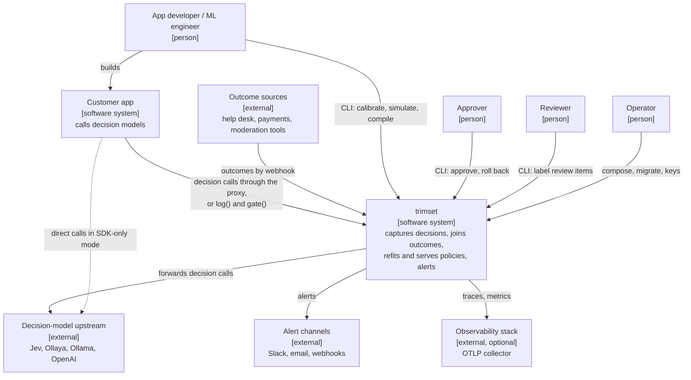

## 3. C4 level 2: containers

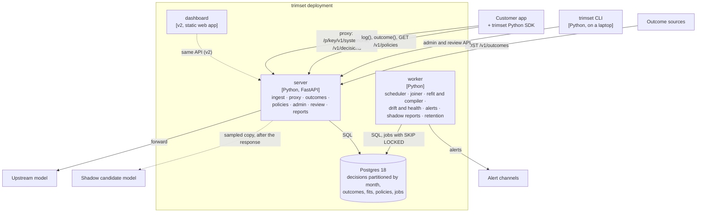

The brief listed more containers. [ADR 0004](adr/0004-process-model-and-jobs.md)
shows which process each one runs in.

## 4. C4 level 3: components

### Server

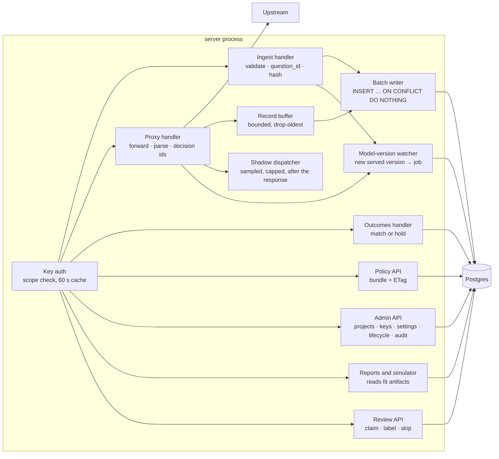

### Worker

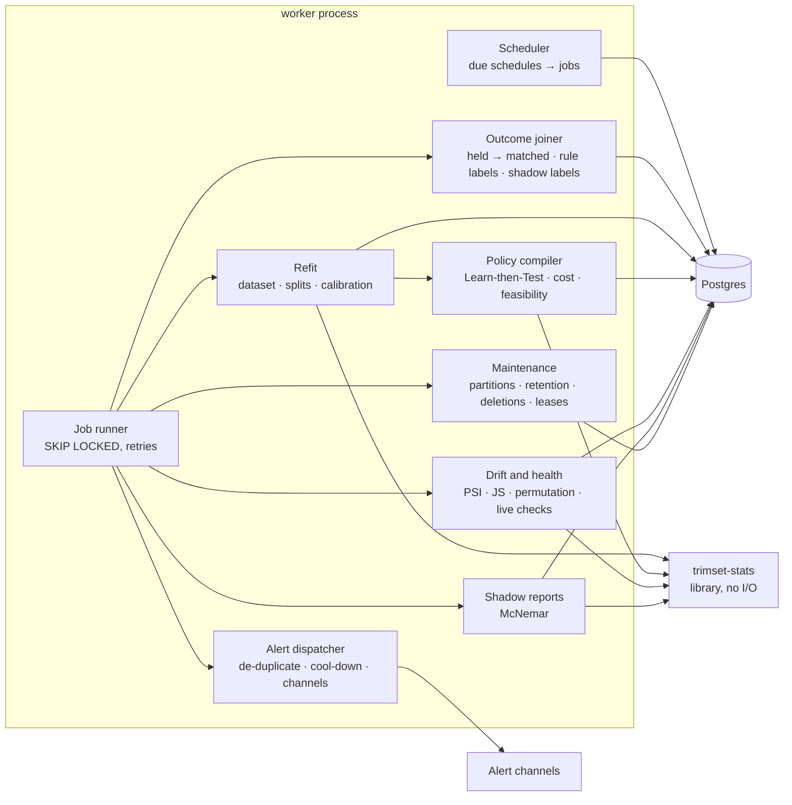

### Where the Phase 1 components live

| Component (traceability matrix) | Process | Package |
|---|---|---|
| api, proxy, auth, review, audit log | server | `trimset-server` |
| joiner | server (write path) and worker (sweeps) | `trimset-server` |
| scheduler, drift, alerts, shadow, retention, policies (refits) | worker | `trimset-server` |
| stats, compiler | worker, and the server's simulator | `trimset-stats` |
| sdk-py, cli | the customer's app, a laptop | `trimset` |
| mock-upstream, datagen | tests and demos | `tools/` |

## 5. Sequence diagrams

### (a) Proxy request with logging

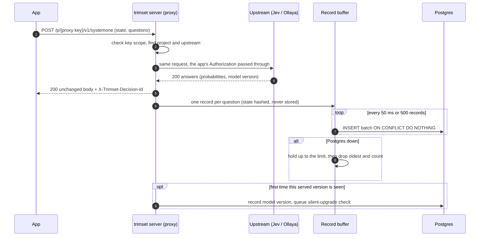

### (b) Late outcome join

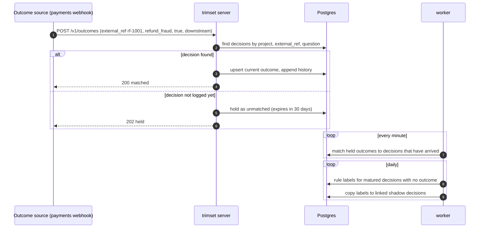

### (c) Scheduled refit → proposal → approval → SDK pickup

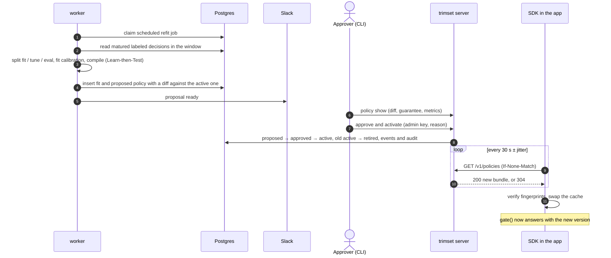

### (d) Drift detection → alert

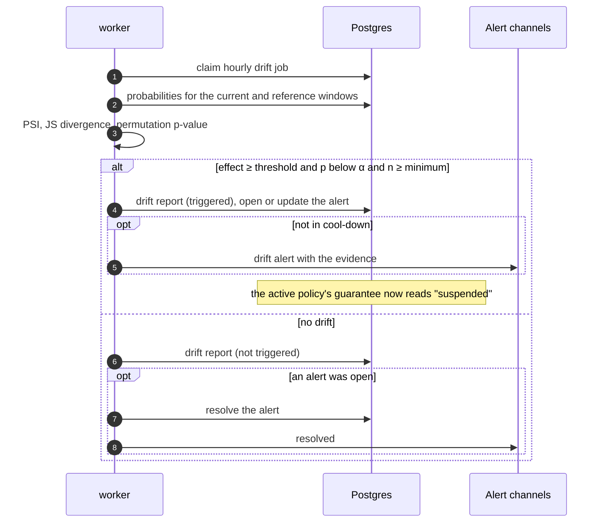

### (e) Shadow comparison

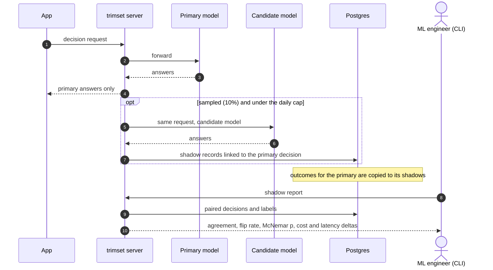

## 6. Data model

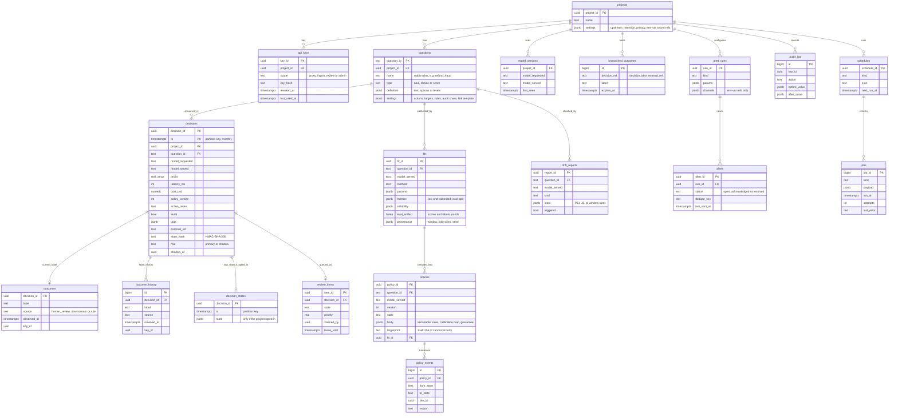

Shadow decisions point to their primary through `decisions.shadow_of`. Every table
carries `project_id`, and every query filters by it (FR-51).

## 7. Lifecycles

### Policy

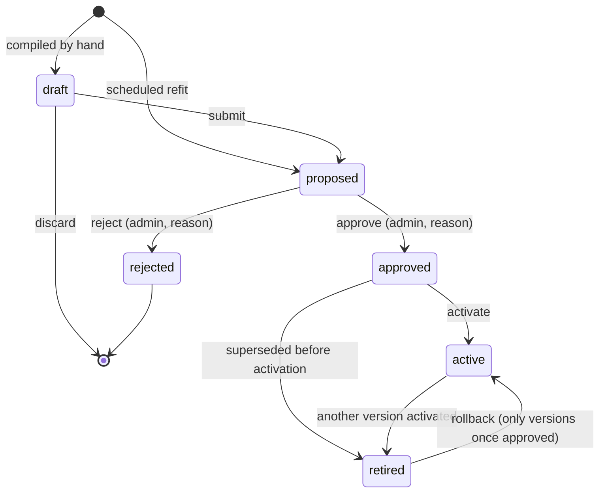

### Review item

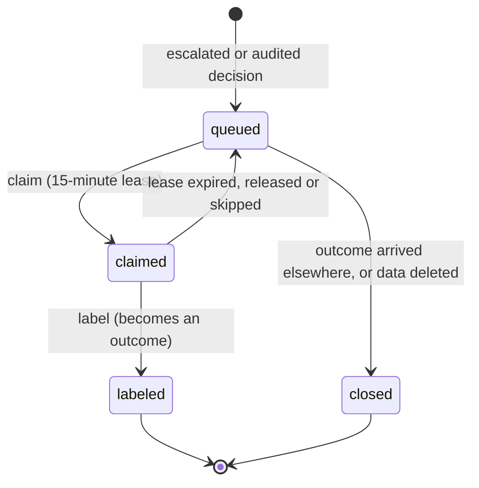

## 8. Deployment

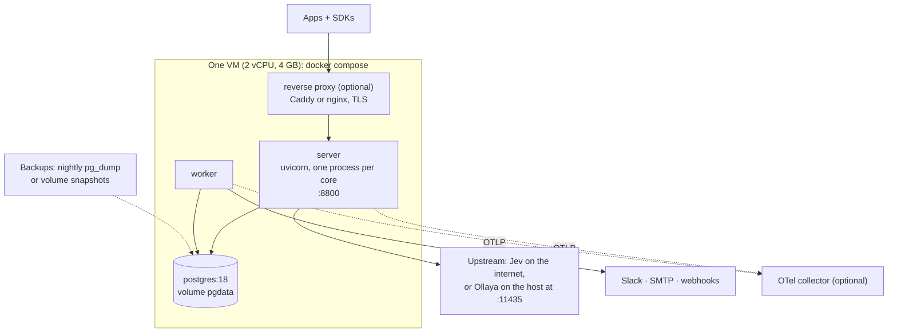

**Scaling, in order of need:**
1. **More servers:** behind a load balancer. They are stateless apart from the record
   buffer.
2. **A second worker:** jobs use `SKIP LOCKED`, so two are safe.
3. **Postgres:** monthly partitions and retention keep it small. A read replica can serve
   reports and the simulator.
4. **ClickHouse:** past about 1 billion decisions, or for heavy analytics, fed by logical
   replication. This needs no API change.

## 9. Data flows and trust boundaries

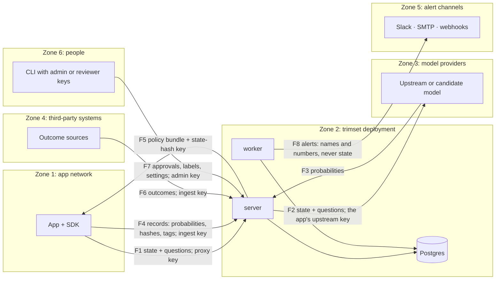

| Flow | What crosses | Protection |
|---|---|---|
| F1, F2, F3 | Raw state, in transit only | TLS; state hashed before storage; never logged |
| F4, F6 | Probabilities, hashes, tags, labels | Ingest key; tag limits and allow-list; per-source keys |
| F5 | Policies and the state-hash key | TLS; key scope; fingerprints |
| F7 | Lifecycle changes, labels, settings | Admin or ingest key; audit log |
| F8 | Alert text | Never contains state or tag values; signed webhooks |

## 10. Threat model (STRIDE)

| ID | Kind | Threat | Mitigation in v0.1 | Left over, or later |
|---|---|---|---|---|
| S1 | Spoofing | **API key leakage.** A stolen key is used to log decisions or send outcomes. | Keys stored as hashes; four narrow scopes (proxy, ingest, review, admin; review added in Phase 3); one key per source recommended; revocation within 60 s; last use shown. | A stolen ingest key can poison data until someone notices. |
| S2 | Spoofing | **Proxy key read from a URL** in access logs. | The `proxy` scope can only call the proxy; trimset's logs redact it; docs for nginx and Caddy; header mode recommended. | Logs outside trimset's control. |
| S3 | Spoofing | Outcome sources that can only sign webhooks and can't send headers. | They need a small relay that adds the ingest key. | Native signature checks for common senders in v0.2. |
| T1 | Tampering | **Poisoned outcomes:** an attacker or a buggy integration sends wrong labels. | Every label records its source and key; proposals show the label mix by source and the change from the previous policy; a human must approve; audit sampling cross-checks. | Subtle poisoning could get past an approver. Label anomaly alerts in v0.2. |
| T2 | Tampering | **Policy tampering** in transit or in the database. | TLS; fingerprints checked by the SDK; only admin keys change state; audit log. | Someone who can write to the database can forge a policy and its fingerprint. Signed policies in v0.2 ([ADR 0008](adr/0008-policy-distribution.md)). |
| T3 | Tampering | Fake decisions sent to distort drift checks or calibration. | Same as S1; drift reports show their sample sizes. | Same as S1. |
| R1 | Repudiation | "Who approved this?" | Audit log with key, time, before and after values, and a reason; one admin key per person recommended. | No user accounts in v0.1, so a shared key hides who it was. |
| I1 | Information disclosure | **Personal data in tags** or `external_ref`. | Size limits; an optional allow-list of tag keys; clear docs; tags never appear in alerts. | A misconfigured app can still put personal data in. |
| I2 | Information disclosure | Reversing state hashes by guessing. | Keyed HMAC, with the key derived from a secret outside the database ([ADR 0009](adr/0009-privacy-model.md)). | Anyone holding both the server secret and the database. |
| I3 | Information disclosure | Reading across projects. | Every query is scoped to the key's project; tests on every endpoint (FR-51). | — |
| I4 | Information disclosure | Secrets in the database or logs. | Only environment-variable names are stored; headers and keys are redacted in logs and traces. | — |
| I5 | Information disclosure | Raw state, where a project has opted in. | Separate table; shorter retention; admin-only reads; every read audited. | Accepted by the project when it opts in. |
| D1 | Denial of service | Floods or huge batches. | Size limits on requests and batches; bounded buffers that drop and count; rate limits through the reverse proxy (documented). | Rate limits per key in v0.2. |
| D2 | Denial of service | A slow upstream. | Timeout per project; logging is separate from the response path. | — |
| D3 | Denial of service | Shadow traffic running up costs. | Sampling share and a daily cap per question. | — |
| E1 | Elevation of privilege | An ingest or proxy key used for admin actions. | Scope checked on every route, denied by default; tests. | — |
| E2 | Elevation of privilege | Server-side request forgery through admin-set URLs (upstreams, shadows, alert webhooks). | No URL can be set through the API. Upstreams and alert channels are defined by the operator in the server environment and picked by name; no redirects are followed. | An operator who defines an internal URL. |
| E4 | Elevation of privilege | **Confused deputy:** an admin key makes the server send a secret (`TRIMSET_SECRET`, a database URL, another project's upstream key) somewhere it chooses. | The API accepts no variable names, headers or URLs. Each upstream key is bound to its own URL in the operator's config; a key paired with an http URL stops the server from starting; `_PROJECTS` limits which projects may use an upstream. | — |
| E3 | Elevation of privilege | Injection through the review link template, for example a `javascript:` URL. | Only admins set it; it must be an absolute http(s) URL; `external_ref` is URL-encoded; a filled link that isn't http(s) is dropped; the v0.1 CLI prints plain text. | The v2 dashboard must still escape it. |

## 11. Changes to Phase 1 that come from this phase

- **FR-01 / record:** `state_sha256` becomes `state_hash`, with `state_hash_alg: "hmac-sha256/1"` ([ADR 0009](adr/0009-privacy-model.md)).
- **FR-07:** `X-Trimset-Decision-Id` carries one id per question, comma-separated in question order ([ADR 0011](adr/0011-proxy-design.md)).
- **FR-52:** a third key scope, `proxy` ([ADR 0011](adr/0011-proxy-design.md)).
- **Homepage:** the adoption snippet needs the `/p/<proxy key>` path. This gets fixed with the other homepage claims before Phase 7.
