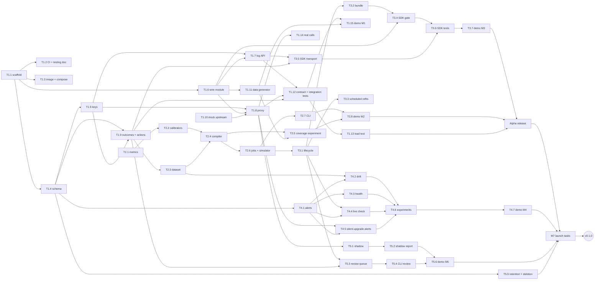
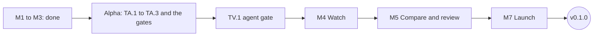

# Phase 4: Plan

**Status:** approved and under way; re-planned after M3 on 2026-11-12 (section 1) · Inputs: [01-requirements.md](01-requirements.md), [02-architecture.md](02-architecture.md), [03-api/](03-api/README.md)

## 1. Shape of the plan

- **Budget:** 10 hours a week, starting 2026-11-16. *Superseded for scheduling by the
  re-plan after M3 below: the hours stay as a measure of each task's size, the dates are gone.*
  - Estimates are your hours, with Claude Code writing most of the code and you
    reviewing, testing and deciding.
  - Every estimate includes tests and docs.
  - A 25% buffer is added to each milestone. Two weeks off at the year end.
- **Two releases instead of one:**
  - **v0.1.0-alpha**, the closed loop: capture → outcomes → calibrate → compile with a
    guarantee → gate in the app. Ships after M3, when its gates are met (the re-plan
    below; this plan first said 2027-07-05). Getting the core in front of users early is
    the main answer to the competition risk (R1).
  - **v0.1.0** adds drift, alerts, shadow models and the review queue. Ships after M7; the
    date is set after the alpha (this plan first said 2027-10-18).
- **Re-plan after every milestone.** Actual hours against estimates set the next
  milestone's dates. M1 is the first real measure of speed, so treat the dates after it
  as provisional.
- **Phases 6 to 8 of the brief move into the milestones:**
  - The testing strategy (`docs/05-testing.md`) is written first, in M1, so CI and the
    coverage gate exist from the first commit.
  - Release work splits between the alpha and M7.
  - The operations doc is written in M7.
- **M6 (dashboard)** is v2, as decided in Phase 0. A rough size for v0.2 (dashboard plus
  TypeScript SDK) is 110–140 hours, re-estimated after launch. The agent gate and the
  assistant ([ADR 0014](adr/0014-agents-and-assistant.md)) add about 35 more; see
  "After v0.1.0" below.

| Milestone | Planned hours | With buffer | Status |
|---|---|---|---|
| M1 Capture | 107 | 134 | **Done 2026-11-11.** Open: T1.14 (real calls) and NFR-02 on a rented VM |
| M2 Calibrate and compile | 69 | 86 | **Done 2026-11-11** |
| M3 Gate | 49 | 61 | **Done 2026-11-12** |
| Alpha release | 16 | 20 | **Next.** Ships when its gates are met (below) |
| M4 Watch | 38 | 48 | Not started |
| M5 Compare and review | 34 | 43 | Not started |
| M7 Launch | 38 | 48 | Not started |
| **Total** | **351** | **440** | v0.1.0 follows M7. No date until the alpha's real pace is known |

### Re-plan after M3 (2026-11-12)

**What happened.** M1 to M3 (225 planned hours, 29 weeks of the original calendar) were
built between 2026-11-10 and 2026-11-12, with Claude Code writing the code and CI testing
every change. The plan counted the maintainer's hours at 10 a week; that was not the
limit, so dates computed from it were the wrong tool. Nothing was cut: all three demos run
in CI, and the nightly coverage experiment (NFR-09) passes.

**Still open from M1 to M3, and only the maintainer can close it:**

- T1.14: real calls to TypeSafe and OpenAI, which need their keys (a few cents).
- NFR-02: ingest at 500 records a second on a rented 2 vCPU VM. On GitHub runners it
  sat at the edge, proxy or not ([ADR 0015](adr/0015-rust-proxy.md)).
- R6: someone who knows hypothesis testing reads [ADR 0006](adr/0006-policy-compiler.md)
  and the compiler before the alpha.

**What changes:**

1. **Gates replace dates.** The alpha ships when TA.1 to TA.3 are done *and* the three
   items above are closed *and* the maintainer has done the one-time setup in
   [releasing.md](releasing.md) (a PyPI pending publisher, the `pypi` environment, GHCR
   visibility) *and* has decided how it is announced. Dates for M4, M5 and M7 are set after
   the alpha, from how long it really took.
2. **TV.1 (the agent gate and Claude Code hook) moves to right after the alpha, before
   M4.** It is 12 planned hours, and this plan said it would move if the re-plan found room.
   The dashboard's drift and alert screens wait one task longer for their endpoints.
3. **The dashboard (M6) was started early,** in a parallel session, on the public API: a
   preview runs at demo.trimset.dev on recorded data. The "served by your install" part
   stays in v0.2. Its remaining screens take endpoints in the order they land: drift
   reports, alerts and rules, review items, the shadow report.
4. **T7.1 is split by what is stable.** The API reference (rendered from `openapi.yaml`)
   and the docs-site skeleton with the pages that exist are done before the alpha
   ([ADR 0016](adr/0016-docs-site.md)); concept pages and integration guides wait until M4
   and M5 have settled what there is to explain.

## 2. Tasks

### M1 Capture: ingest, proxy, outcomes, storage

| ID | Task | Covers | Hours |
|---|---|---|---|
| T1.1 | Monorepo scaffold: uv workspace, the three packages, ruff, mypy, pytest, pre-commit, `LICENSE` | ADR 0002, 0013 | 6 |
| T1.2 | CI on GitHub Actions (lint, types, unit, integration with a Postgres service, image build); write `docs/05-testing.md` first | NFR-08 | 6 |
| T1.3 | Docker image; compose (postgres, migrate, server, worker); `/health`, `/ready`; JSON logs; OpenTelemetry | NFR-01, NFR-13, NFR-17 | 6 |
| T1.4 | Migration runner and first schema; monthly partitions | ADR 0003 | 8 |
| T1.5 | Projects; keys (four scopes, hashed, cached, revocation); `trimset-server` bootstrap commands | FR-51–53 | 6 |
| T1.6 | Wire module in `trimset`: canonical JSON, `question/1`, `question_id`, state hash, responses into records; vector tests | FR-03, FR-09 | 8 |
| T1.7 | `POST /v1/decisions:log`: validation, question registration, batched inserts | FR-01, FR-02 | 8 |
| T1.8 | Proxy (detail below the table) | FR-04–08, NFR-03, NFR-06 | 14 |
| T1.9 | Outcomes: join, held outcomes, corrections, default-by-rule job; `POST /v1/decisions:actions` | FR-10–13, FR-33 | 12 |
| T1.10 | Mock upstream: both formats, seeded, latency and error injection, version switch | FR-59 | 6 |
| T1.11 | Data generator: all six scenario shapes, three in full (UC-1, UC-2, UC-3); planted miscalibration, delays, model swap | FR-60 | 10 |
| T1.12 | Contract tests against `openapi.yaml`; integration tests | — | 6 |
| T1.13 | Load test on a 2 vCPU VM; keep Python or take the Rust escape hatch | NFR-02, NFR-03 | 6 |
| T1.14 | Real calls: Jev, Ollaya, and OpenAI's error format (the Phase 3 assumption) | — | 2 |
| T1.15 | Demo `examples/m1-capture` | — | 3 |

T1.8 covers:
- both key modes, forwarding and the header rules;
- decision ids;
- the buffer and its writer;
- errors in the upstream's format;
- multipart requests;
- model versions;
- operator-defined upstreams, with each key bound to its URL and no redirects followed
  (ADR 0011).

### M2 Calibrate and compile

| ID | Task | Covers | Hours |
|---|---|---|---|
| T2.1 | Metrics and reliability bins; golden tests against scikit-learn | FR-17 | 8 |
| T2.2 | Calibrators (temperature, Platt, isotonic) and method selection by cross-validation; golden tests | FR-16 | 10 |
| T2.3 | Dataset builder: matured labels, window, de-duplication, splits, coverage | FR-14, FR-18, FR-19 | 8 |
| T2.4 | Compiler (detail below the table) | FR-20–25 | 16 |
| T2.5 | Coverage experiment, 200 seeds, run nightly in CI | NFR-09, SM-2 | 6 |
| T2.6 | Fit and compile jobs; storing fits and policies; simulator endpoint | FR-26 | 8 |
| T2.7 | CLI: config, calibrate, simulate, compile, policy show and diff, decisions tail, coverage, export, `--json` | FR-55, FR-58 | 10 |
| T2.8 | Demo `examples/m2-refund-fraud` | UC-1 | 3 |

T2.4 covers:
- the rule forms;
- Learn-then-Test;
- the Bonferroni split;
- feasibility;
- the labels-needed count;
- cost targets;
- guarantee statements.

### M3 Gate: SDK and policy lifecycle

| ID | Task | Covers | Hours |
|---|---|---|---|
| T3.1 | Policy lifecycle: transitions, events, audit log, rollback | FR-27–29, FR-54 | 8 |
| T3.2 | Policy bundle with ETag; guarantee status | FR-32, ADR 0008 | 4 |
| T3.3 | Scheduled refits that create proposals, with a diff and the label-source mix | FR-30 | 6 |
| T3.4 | SDK: client, policy cache, the gate algorithm, audit sampling, defaults and reasons | FR-31–35, FR-37 | 12 |
| T3.5 | SDK transport: `log`, `log_exchange`, `outcome`, action reports, buffers, backoff; `instrument()` for in-process models such as Hugging Face pipelines | FR-36 | 10 |
| T3.6 | SDK tests: vectors, gate examples, chaos, gate benchmark, propagation time | NFR-04, NFR-05, NFR-07 | 6 |
| T3.7 | Demo `examples/m3-ticket-triage` | UC-2 | 3 |

### Alpha release

| ID | Task | Covers | Hours |
|---|---|---|---|
| TA.1 | Release pipeline: multi-arch image on GHCR, PyPI trusted publishing, changelog, semver tags | NFR-16 | 6 |
| TA.2 | Quickstart and self-hosting pages; README | NFR-20 | 6 |
| TA.3 | Homepage: claims match the alpha, `[X]%` from demo data (the proxy-key snippet and the `trimset.dev` deploy, on Cloudflare, were done early on 2026-11-11) | — | 4 |

### M4 Watch: drift and alerts

| ID | Task | Covers | Hours |
|---|---|---|---|
| T4.1 | Alerts: rules, signed webhooks, Slack, email, cool-down, resolve notices | FR-42–44 | 10 |
| T4.2 | Drift job: windows, PSI, JS divergence, permutation tests, reports | FR-38, FR-41 | 8 |
| T4.3 | Health checks | FR-40 | 6 |
| T4.4 | Live policy check (confidence sequences); suspending guarantees | FR-40, ADR 0007 | 6 |
| T4.5 | Silent-upgrade alerts | FR-39 | 2 |
| T4.6 | Experiments for SM-3 (false alarms) and SM-4 (time to detect a swap) | SM-3, SM-4 | 4 |
| T4.7 | Demo `examples/m4-silent-upgrade` | UC-2 | 2 |

### M5 Compare and review

| ID | Task | Covers | Hours |
|---|---|---|---|
| T5.1 | Shadow traffic in the proxy; copying labels to shadows | FR-45 | 6 |
| T5.2 | Shadow report (McNemar, flip rate, deltas) | FR-46 | 5 |
| T5.3 | Review queue: filling rules, claims and leases, label, skip, http(s)-only links, raw-state gate | FR-47–50 | 8 |
| T5.4 | Keyboard review session in the CLI | FR-48 | 5 |
| T5.5 | Retention, partition drops, deletions | FR-56, FR-57, NFR-14 | 7 |
| T5.6 | Demo `examples/m5-model-routing` | UC-3 | 3 |

### M7 Launch

| ID | Task | Covers | Hours |
|---|---|---|---|
| T7.1 | Docs site: concepts, an API reference built from `openapi.yaml`, integration guides (Jev, Ollaya, Ollama, OpenAI, Hugging Face transformers, LangGraph, decision-circuits) | NFR-20 | 14 |
| T7.2 | Security: dependency audit, secret scan, license check in CI; threat-model review | NFR-11, NFR-18 | 4 |
| T7.3 | `docs/06-operations.md`: runbooks, SLOs | Brief, Phase 8 | 5 |
| T7.4 | Community files, issue labels, `ROADMAP.md` | — | 5 |
| T7.5 | Homepage: final numbers (the site v2 pages, use cases included, were built early on 2026-11-11) | — | 6 |
| T7.6 | Fresh-machine quickstart check; upgrade test from the alpha; launch | NFR-15, NFR-20 | 4 |

### After v0.1.0: agents and the assistant

Not in v0.1's hours or dates ([ADR 0014](adr/0014-agents-and-assistant.md)). TV.1 can
start once M3 ships; if the re-plan after M3 finds room, it moves before the launch.

| ID | Task | Covers | Hours |
|---|---|---|---|
| TV.1 | MCP server (gate, outcome and explain tools) and a Claude Code `PreToolUse` hook demo: a decision model and an approved policy decide whether an agent's tool call runs, asks a human, or is blocked | UC-5, FR-31–35 | 12 |
| TV.2 | Assistant in the v2 dashboard: a text model with read-only tools over fits, simulations, drift reports and policy diffs, explaining trade-offs in plain words; it may draft a proposal, never approve one. Off by default; the operator picks the model | FR-61, FR-27–29, FR-54 | 24 |

## 3. Dependencies

The critical path runs through the proxy and outcomes (M1), the compiler (M2) and the
SDK (M3). M4 and M5 depend mostly on M1, so either can move earlier if M2 stalls.

## 4. Sequence

The original Gantt chart assumed 10 hours a week from 2026-11-16 and is retired with the
dates (see the re-plan above). The order stands:

## 5. Risks

| ID | Risk | Likelihood | Impact | Mitigation |
|---|---|---|---|---|
| R1 | **Langfuse or Arize add native decision-model support.** | Medium | High | Ship the alpha as soon as its gates are met, not at the end of the v0.1 plan. Own what they are unlikely to build: finite-sample guarantees, delayed and selective labels, typed questions. Integrate rather than compete: OpenTelemetry export, and an import path from their traces. Publish the research track (`research/`). |
| R2 | **The decision-model category fades.** | Low–medium. OpenAI went generally available, and TypeSafe, Ollaya and Ollama all moved within two months. | High | The core (calibration, thresholds, guarantees, drift) works on any probabilities, through the `direct` record format. Wire adapters stay thin and isolated. |
| R3 | **Solo-maintainer bandwidth.** | High | High | 25% buffer; re-plan after each milestone; every milestone ships something usable; the cut list below; good-first-issues from M3. |
| R4 | Vendor wire formats change (TypeSafe's spec is at 0.2.0). | Medium | Medium | Recorded fixtures and contract tests per vendor; a monthly changelog check; versioned adapters. |
| R5 | Python misses the ingest or proxy latency targets. | Medium | Medium | Measured in M1 (T1.13): ingest held, the proxy didn't, and its hot path is now Rust (ADR 0015). |
| R6 | A bug makes a guarantee false. | Low | High (trust) | Golden tests; the coverage experiment in CI (NFR-09); a statistician reviews the compiler before the alpha. |
| R7 | Synthetic numbers mislead. | Medium | Medium | Label every synthetic figure as such. Find 1–2 design partners with real traffic before v0.1.0. |
| R8 | A security flaw in the proxy or the key handling. | Medium | High | Threat model; operator allowlists; dependency and secret scans in CI; `SECURITY.md` with a contact at the alpha. |
| R9 | API costs for real-call tests. | Low | Low | The mock upstream for every test; Ollaya runs locally for free; real calls only in T1.14 and before releases. |

**Cut list, in order, if behind:**
1. Multipart (image) requests in the proxy.
2. The keyboard review session in the CLI (the API stays).
3. Per-option thresholds for choice questions.
4. Shadow traffic, moved to v0.2.
5. Email and Slack alerts (signed webhooks stay).

## 6. Definition of Done

**A task** is done when:
- the code has tests (unit or property, and golden tests for anything statistical);
- CI is green and coverage didn't drop;
- the docs that describe it are updated (API reference, a docs page, `CLAUDE.md` if a
  convention changed);
- the commit is a Conventional Commit that names its FR or NFR ids;
- there are no secrets.

**A milestone** is done when:
- every task is done;
- its demo in `examples/` runs end to end from a clean checkout against the mock
  upstream (and against Ollaya where it applies);
- the acceptance criteria of its user stories pass as tests;
- its NFRs are measured and recorded;
- estimate against actual is recorded, and the plan is re-based;
- it is tagged as a pre-release.

**A release** is done when:
- every milestone in it is done;
- the full CI passes, including the security and license checks;
- there is a changelog and a semver tag;
- images (amd64 and arm64) are on GHCR and packages are on PyPI;
- the quickstart works on a fresh VM in 10 minutes or less;
- the homepage claims match what shipped;
- upgrade notes and known limitations are written.

## 7. Decided before Phase 5 (2026-11-10)

1. **Tests run in CI.** GitHub Actions runs the full suite on every push. Locally, run
   only lint and single test files: the maintainer's machine is short on memory. Load
   tests and the nightly experiments never run locally.
2. **The repository is public:** `github.com/trimset/trimset`.
3. **API keys for T1.14,** in M1: a TypeSafe key and an OpenAI key, for a few cents of
   real calls. They are kept out of the repo, in CI secrets.
